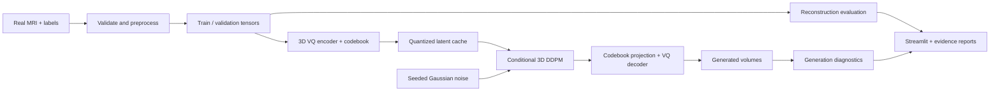

# 3D MRI Research

**A local research platform for MRI preprocessing, vector-quantized representation learning, and 3D latent diffusion.**

[](https://github.com/reetamdan/3d-mri/actions/workflows/tests.yml)


Explore real MRI volumes, build reproducible datasets, train a 3D VQ-VAE/VQ-GAN
and conditional latent DDPM, and inspect the results through a Streamlit dashboard.
The project includes a college M1–M4 assessment pack with methodology, implementation
traceability, measured baseline results, and a trained-model demo guide.

**Research v2** adds multi-resolution denoising, EMA, v-prediction, classifier-free
guidance, DDIM, whole-cohort memorization checks, independent-cohort audit support,
uncertainty, portable artifacts and a packaged CLI. See the
[upgrade guide](docs/research-upgrade.md) and [model card](docs/model-card.md).

The [representation-first knee study](docs/research_v2_report.md) adds compact
MONAI KL autoencoders, anisotropic sampling, structural objectives, train-fitted
latent scaling, controlled Min-SNR diagnostics and fair conventional augmentation
controls. On the frozen **96/24** cohort, anisotropic KL improves three-seed
reconstruction to **26.802 ± 0.199 dB PSNR / 0.8578 ± 0.0092 SSIM**. Fine-detail
gates still fail, so this is a reconstruction improvement rather than established
synthetic-MRI utility. Its cohort is separate from the 256/60 comparison below.

> **Research prototype — not for clinical diagnosis or treatment.** The current
> reconstruction model is functional and evaluated. Randomly generated volumes
> remain blurry and do not reliably reproduce coherent knee anatomy.

## Features

- **NIfTI data pipeline:** validation, canonical RAS orientation, unit-aware
  resampling, configurable crop/pad/resize, normalization, and NumPy/PyTorch export.
- **Leakage-aware splits:** subject-level NIfTI grouping and preservation of
  MRNet's official train/validation assignments.
- **MRI dashboard:** slice navigation, optional 3D rendering, intensity analysis,
  synchronized preprocessing comparisons, quality reports, and export.
- **3D generative models:** VQ-VAE with optional EMA codebook/reset, optional
  patch-adversarial VQ-GAN training, contiguous latent caching, and configurable
  multiresolution DDPM with attention, weight EMA, epsilon/v prediction and CFG/DDIM.
- **Representation research:** optional official MONAI KL with isotropic/
  anisotropic lattices, deterministic posterior-mean evaluation, adaptive 3D
  MS-SSIM/gradient objectives, explicit frozen medical features and matched budgets.
- **Trained-model inference:** reconstruct validation inputs and sample fresh
  volumes with a chosen seed from the dashboard.
- **Reproducible experiments:** explicit configurations, checkpoint resume,
  validation-based selection, content checksums, model lineage, and computed evidence.
- **Evaluation:** paired MSE/MAE/PSNR/SSIM, adaptive 3D MS-SSIM diversity,
  continuity diagnostics, and a separate classification augmentation comparison.

## Architecture



## Quick start

Use **Python 3.12** for the tested setup. Run these commands from a terminal:

```bash
git clone https://github.com/reetamdan/3d-mri.git
cd 3d-mri
python -m venv .venv
```

Activate the environment:

```powershell
# Windows PowerShell
.\.venv\Scripts\Activate.ps1
```

```bash
# macOS / Linux
source .venv/bin/activate
```

For the dashboard and CPU tests, install the CPU PyTorch wheel followed by the
application dependencies:

```bash
python -m pip install torch==2.14.1 --index-url https://download.pytorch.org/whl/cpu
python -m pip install -r requirements.txt
python -m pip install -e ".[dev,metrics]"
python -m streamlit run app/streamlit_app.py
```

Open **http://127.0.0.1:8501**. A fresh clone starts with an empty dataset state.
Datasets, virtual environments, trained weights, and generated run folders are
local artifacts; they are excluded from version control. The app does not
download data on startup.

### NVIDIA GPU setup

Current local verification and the constrained representation study use an
RTX 3060 Laptop GPU with 6 GiB VRAM and patched PyTorch `2.14.1+cu130`
(CUDA 13.0). On compatible NVIDIA hardware:

```bash
python -m pip install -r requirements-cuda.txt
python -c "import torch; print(torch.__version__); print('CUDA:', torch.cuda.is_available())"
```

`requirements-lock.txt` records the patched Windows/CUDA environment.
`requirements.txt` contains the general dependency ranges. Consult the
[PyTorch installation guide](https://pytorch.org/get-started/locally/) for other hardware.
Historical baseline training used `2.11.0+cu128`; its original software versions
remain recorded with the measured results. Published installation instructions
use the patched runtime.

## Data workflows

### 1. NIfTI inspection and preprocessing

Organize de-identified `.nii` or `.nii.gz` volumes by subject:

```text
data/raw/
  subject_001/
    scan.nii.gz
  subject_002/
    scan.nii.gz
```

Edit [`configs/config.yaml`](configs/config.yaml), then run:

```bash
python scripts/validate_dataset.py
python scripts/preprocess.py
python scripts/generate_report.py
```

Relative configuration paths resolve against the YAML file. Flat datasets
require an explicit `file_path,patient_id` manifest. The dashboard's **Dataset
Overview → MRI Viewer → Preprocessing → Dataset Quality → Export** pages expose
the same data-processing workflow.

For small real-data integration samples from 3D Slicer:

```bash
python -m pip install -r requirements-samples.txt
python scripts/download_sample_data.py
```

These three brain scans represent two subjects and support software testing;
they are separate from the knee-model training cohort.

See [the data-pipeline reference](docs/data-pipeline.md) for geometry, tensor
layouts, normalization, splitting, export metadata, and metric conventions.

### 2. Real MRNet knee baseline

The explicit downloader requests a reproducible **96-train / 24-validation**
subset, with all three acquired planes and a 1 GiB source-array budget:

```bash
python scripts/download_mrnet_subset.py --train 96 --validation 24 --max-mib 1024
python scripts/run_m4.py
```

The M4 configurations require CUDA. The runner preprocesses sagittal series,
trains the VQ and diffusion models, selects checkpoints using validation error,
evaluates reconstruction and generation, and exports evidence. Training settings
are in [`configs/m4-vq.yaml`](configs/m4-vq.yaml) and
[`configs/m4-diffusion.yaml`](configs/m4-diffusion.yaml).

The downloader uses the public `cjinny/mrnet-v1` Kaggle mirror, version 1. Its
manifest records the source, selection seed, class support, hashes, and Kaggle's
unspecified license metadata. Dataset usage is subject to the original source's
terms; the repository does not redistribute MRI data. An existing extracted
MRNet dataset can also be supplied through `scripts/research.py prepare-mrnet`.

To resume the same experiment or regenerate its evidence:

```bash
python scripts/run_m4.py --resume
python scripts/export_m4_evidence.py --run runs/M4-MRNET-20261021
```

After training, open **MRNet Dataset** and **Model Experiments** in the dashboard.
The latter supports live VQ reconstruction and new-seed generation. Historical
smoke-test artifacts are excluded from research results.

### 3. Research v2 comparison and independent evaluation

```bash
python scripts/download_mrnet_subset.py --output data/mrnet/MRNet-research-v2 --train 256 --validation 60 --planes sagittal --workers 8 --max-mib 1024
mri3d-study
python scripts/sampling_ablation.py
python scripts/summarize_study.py
```

This runs matched-budget control/upgrade arms with three seeds on the same frozen
256/60 cohort. It is an exploratory validation study, not a new independent test.
Set **Research runs directory** to `runs/RESEARCH-V2` to inspect the arms. New
datasets/checkpoints remain local artifacts and are not included in Git pull.

The installed `mri3d` CLI also exposes `freeze-protocol`, external-cohort
`evaluate-reconstruction`/`evaluate-generation`, `tokenizer-diagnostics`,
`evaluate-features`, `prepare-review`, `summarize-review`, and `relocate`.
The [upgrade guide](docs/research-upgrade.md) explains their contracts and limits.

Default preprocessing/training presets are included in the installed wheel, so
commands can resolve their defaults outside the source checkout:

```bash
mri3d show-config --preset models.yaml
python -m scripts.validate_dataset
```

Use `--config <file.yaml>` to supply an editable override. Explicit preprocessing
YAML paths resolve relative to that file; bundled preprocessing paths resolve to
`data/` and `logs/` in the current workspace. `mri3d-study` accepts
`--baseline-config` and `--upgraded-config`; the study uses each preset's configured
device and geometry. Public YAML files in `configs/` are the single source for
bundled presets; local override files are excluded from the wheel.

### 4. Representation-first knee study (96/24)

Install the optional research libraries after selecting the appropriate PyTorch
build, then run a fresh matched-budget screening study:

```bash
python -m pip install -e ".[dev,metrics,research]"
python scripts/representation_study.py --output runs/AE-BAKEOFF-new --device cuda
```

`requirements-research.txt` records direct research-package pins used in the
measured environment. All nine arm definitions are bundled YAML presets. The
[study report](docs/research_v2_report.md) gives the completed 15-run table,
three-seed confirmations, negative perceptual/decoder/diffusion findings, resource
measurements and commands to reproduce each distinct comparison. Run heavy jobs
serially on memory-constrained hosts. Datasets, weights and generated images stay
in ignored local directories.

The installed CLI also exposes `train-autoencoder`, `evaluate-autoencoder`,
`cache-representation` and `generate-balanced`. Full-cohort KL diffusion and
serious synthetic augmentation require model-bound quality-gate receipts. A
tiny artificial/integration test is not a passed MRI-quality gate.

## Reference results

The recorded reduced-cohort experiment used 128×128×32 sagittal inputs:

| Stage | Completed epochs | Optimizer updates | Selected epoch |
|---|---:|---:|---:|
| 3D VQ-VAE | 40 | 1,920 | 38 |
| Conditional latent DDPM | 300 | 14,400 | 283 |

| Validation metric | Trained VQ | Half-resolution interpolation reference |
|---|---:|---:|
| MSE ↓ | 0.01537 | 0.02975 |
| MAE ↓ | 0.07493 | 0.08920 |
| PSNR ↑ | 24.29968 dB | 21.36067 dB |
| SSIM ↑ | 0.76587 | 0.77707 |

The learned reconstruction improves intensity errors and PSNR, while the
interpolation reference retains slightly higher SSIM. Validation was used for
checkpoint selection. These are internal baseline results, not independent
test-set performance or evidence of anatomical validity.

See [the published baseline summary](docs/results/m4-baseline.md) for the
protocol and limitations. Complete, locally generated evidence lives in each
run's `evidence.json` and `evidence.md` after reproducing the experiment.

### Research v2 results

On the same **256/60** exploratory cohort, three matched training seeds produced:

| Validation reconstruction | Control | Upgraded |
|---|---:|---:|
| PSNR, mean ± seed SD | 24.24292 ± 0.08266 dB | **25.17329 ± 0.07948 dB** |
| SSIM, mean ± seed SD | 0.76283 ± 0.00661 | **0.79809 ± 0.00576** |

The interpolation reference on these same 60 exams had PSNR 21.20469 dB and
SSIM 0.76958. See [the complete research-v2 results](docs/results/research-v2.md)
for every seed, tokenizer diagnostics, uncertainty scope and limitations.
These results do not establish independent generalization or anatomical validity.

## Repository layout

```text
app/            Streamlit data and model workspaces
configs/        Reusable preprocessing and training configurations
src/
  data/         Loading, validation, preprocessing, splitting, and datasets
  models/       3D VQ-VAE/VQ-GAN and U-Net/DDPM
  training/     Training, sampling, evaluation, and evidence export
  visualization/ Slice, histogram, and volume plots
  utils/        Configuration, seeds, logging, and integrity checks
scripts/        Explicit download, preprocessing, training, and reporting CLIs
tests/          Unit, integration, and local trained-checkpoint acceptance tests
docs/           Methodology, assessment deliverables, and reference results
data/           Local dataset scaffold; contents excluded from Git
```

## Testing

```bash
python -m ruff check .
python -m mypy
python -m pytest -q --cov --cov-report=term-missing
```

The representation-study extension passed **184 automated tests** with **72.88% automated
statement/branch coverage across `src/`, `app/`, `mri3d/`, and `scripts/`**.
An empty-data clean checkout with CUDA hidden passed **178 tests**, with six
expected skips and **71.42% coverage**.
Mypy checks all **81 runtime source files**.
Tests include orchestration/resume,
protocol reservation, missing-hash overlap rejection, persistent sample browsing,
cache invalidation, an isolated wheel install, and actual CUDA/live-checkpoint
inference. The live test writes into a temporary copy of its run.

See the [engineering verification record](docs/engineering-verification.md) for
the current scope, the [output/usefulness assessment](docs/results/output-verification.md)
for independently recomputed M4 metrics and the completed augmentation probe, and
the [original UI record](docs/ui-verification.md) for
historical browser checks. On a fresh clone, tests requiring downloaded samples or
completed checkpoints skip; tests never download data automatically. GitHub
Actions defines Linux/Windows offline CPU jobs with lint, runtime-package type
checks, wheel-install verification, and a 70% statement/branch coverage floor.
A manual trusted-main GPU workflow supports an operator-provisioned runner.
Local CUDA tests skip explicitly when no CUDA device is available.

## Configuration and credentials

Reusable YAML configurations belong in `configs/`. Store machine-specific
overrides as `configs/*.local.yaml`; those files are ignored. Environment files,
Streamlit secrets, service credentials, model weights, datasets, logs, and caches
are also ignored. Default application workflows do not require API tokens.

Read [SECURITY.md](SECURITY.md) for credential handling and private vulnerability
reporting. Dataset and run manifests can contain local paths and should stay in
their ignored output directories.

## Documentation

- [College M1–M4 submission pack](docs/milestones/README.md)
- [M4 demonstration guide](docs/milestones/m4-demo.md)
- [Presentation outline](docs/milestones/presentation.md)
- [Verification record](docs/milestones/verification.md)
- [Full application and UI verification](docs/ui-verification.md)
- [Research v2 upgrade and weakness-response matrix](docs/research-upgrade.md)
- [Model card](docs/model-card.md)
- [Research-v2 measured results](docs/results/research-v2.md)
- [Full modeling and downstream workflow](docs/milestones-2-5.md)
- [Data-pipeline reference](docs/data-pipeline.md)
- [Original technical Milestone 1 PRD](PRD.md)

## Research foundations

The implementation is a compact research baseline informed by
[Medical Diffusion](https://arxiv.org/abs/2211.03364),
[VQ-VAE](https://arxiv.org/abs/1711.00937),
[DDPM](https://arxiv.org/abs/2006.11239), and
[Latent Diffusion Models](https://arxiv.org/abs/2112.10752).
It does not claim an exact reproduction of the reference systems. Full citations
and algorithm justifications are in the [M2 document](docs/milestones/m2-planning-justification.md).
