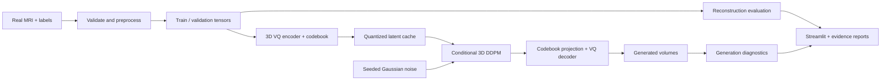

# 3D MRI Research

**A local research platform for MRI preprocessing, vector-quantized representation learning, and 3D latent diffusion.**

[](https://github.com/reetamdan/3d-mri/actions/workflows/tests.yml)


Explore real MRI volumes, build reproducible datasets, train a 3D VQ-VAE/VQ-GAN
and conditional latent DDPM, and inspect the results through a Streamlit dashboard.
The project includes a college M1–M4 assessment pack with methodology, implementation
traceability, measured baseline results, and a trained-model demo guide.

> **Research prototype — not for clinical diagnosis or treatment.** The current
> reconstruction model is functional and evaluated. Randomly generated volumes
> remain blurry and do not reliably reproduce coherent knee anatomy.

## Features

- **NIfTI data pipeline:** validation, canonical RAS orientation, unit-aware
  resampling, configurable crop/pad/resize, normalization, and NumPy/PyTorch export.
- **Leakage-aware splits:** subject-level NIfTI grouping and preservation of
  MRNet's official train/validation assignments.
- **MRI dashboard:** slice navigation, optional 3D rendering, intensity analysis,
  synchronized preprocessing comparisons, quality reports, and export.
- **3D generative models:** VQ-VAE, optional patch-adversarial VQ-GAN training,
  quantized latent caching, and time/label-conditioned DDPM with optional
  bottleneck spatial/depth attention.
- **Trained-model inference:** reconstruct validation inputs and sample fresh
  volumes with a chosen seed from the dashboard.
- **Reproducible experiments:** explicit configurations, checkpoint resume,
  validation-based selection, content checksums, model lineage, and computed evidence.
- **Evaluation:** paired MSE/MAE/PSNR/SSIM, adaptive 3D MS-SSIM diversity,
  continuity diagnostics, and a separate classification augmentation comparison.

## Architecture



## Quick start

Use **Python 3.12** for the tested setup. Run these commands from a terminal:

```bash
git clone https://github.com/reetamdan/3d-mri.git
cd 3d-mri
python -m venv .venv
```

Activate the environment:

```powershell
# Windows PowerShell
.\.venv\Scripts\Activate.ps1
```

```bash
# macOS / Linux
source .venv/bin/activate
```

For the dashboard and CPU tests, install the CPU PyTorch wheel followed by the
application dependencies:

```bash
python -m pip install torch==2.14.1 --index-url https://download.pytorch.org/whl/cpu
python -m pip install -r requirements.txt
python -m streamlit run app/streamlit_app.py
```

Open **http://127.0.0.1:8501**. A fresh clone starts with an empty dataset state.
Datasets, virtual environments, trained weights, and generated run folders are
local artifacts; they are excluded from version control. The app does not
download data on startup.

### NVIDIA GPU setup

The publication environment uses an RTX 5070 Ti Laptop GPU and patched PyTorch
`2.14.1+cu130` (CUDA 13.0). On compatible NVIDIA hardware:

```bash
python -m pip install -r requirements-cuda.txt
python -c "import torch; print(torch.__version__); print('CUDA:', torch.cuda.is_available())"
```

`requirements-lock.txt` records the patched Windows/CUDA environment.
`requirements.txt` contains the general dependency ranges. Consult the
[PyTorch installation guide](https://pytorch.org/get-started/locally/) for other hardware.
Historical baseline training used `2.11.0+cu128`; its original software versions
remain recorded with the measured results. Published installation instructions
use the patched runtime.

## Data workflows

### 1. NIfTI inspection and preprocessing

Organize de-identified `.nii` or `.nii.gz` volumes by subject:

```text
data/raw/
  subject_001/
    scan.nii.gz
  subject_002/
    scan.nii.gz
```

Edit [`configs/config.yaml`](configs/config.yaml), then run:

```bash
python scripts/validate_dataset.py
python scripts/preprocess.py
python scripts/generate_report.py
```

Relative configuration paths resolve against the YAML file. Flat datasets
require an explicit `file_path,patient_id` manifest. The dashboard's **Dataset
Overview → MRI Viewer → Preprocessing → Dataset Quality → Export** pages expose
the same data-processing workflow.

For small real-data integration samples from 3D Slicer:

```bash
python -m pip install -r requirements-samples.txt
python scripts/download_sample_data.py
```

These three brain scans represent two subjects and support software testing;
they are separate from the knee-model training cohort.

See [the data-pipeline reference](docs/data-pipeline.md) for geometry, tensor
layouts, normalization, splitting, export metadata, and metric conventions.

### 2. Real MRNet knee baseline

The explicit downloader requests a reproducible **96-train / 24-validation**
subset, with all three acquired planes and a 1 GiB source-array budget:

```bash
python scripts/download_mrnet_subset.py --train 96 --validation 24 --max-mib 1024
python scripts/run_m4.py
```

The M4 configurations require CUDA. The runner preprocesses sagittal series,
trains the VQ and diffusion models, selects checkpoints using validation error,
evaluates reconstruction and generation, and exports evidence. Training settings
are in [`configs/m4-vq.yaml`](configs/m4-vq.yaml) and
[`configs/m4-diffusion.yaml`](configs/m4-diffusion.yaml).

The downloader uses the public `cjinny/mrnet-v1` Kaggle mirror, version 1. Its
manifest records the source, selection seed, class support, hashes, and Kaggle's
unspecified license metadata. Dataset usage is subject to the original source's
terms; the repository does not redistribute MRI data. An existing extracted
MRNet dataset can also be supplied through `scripts/research.py prepare-mrnet`.

To resume the same experiment or regenerate its evidence:

```bash
python scripts/run_m4.py --resume
python scripts/export_m4_evidence.py --run runs/M4-MRNET-20261021
```

After training, open **MRNet Dataset** and **Model Experiments** in the dashboard.
The latter supports live VQ reconstruction and new-seed generation. Historical
smoke-test artifacts are excluded from research results.

## Reference results

The recorded reduced-cohort experiment used 128×128×32 sagittal inputs:

| Stage | Completed epochs | Optimizer updates | Selected epoch |
|---|---:|---:|---:|
| 3D VQ-VAE | 40 | 1,920 | 38 |
| Conditional latent DDPM | 300 | 14,400 | 283 |

| Validation metric | Trained VQ | Half-resolution interpolation reference |
|---|---:|---:|
| MSE ↓ | 0.01537 | 0.02975 |
| MAE ↓ | 0.07493 | 0.08920 |
| PSNR ↑ | 24.29968 dB | 21.36067 dB |
| SSIM ↑ | 0.76587 | 0.77707 |

The learned reconstruction improves intensity errors and PSNR, while the
interpolation reference retains slightly higher SSIM. Validation was used for
checkpoint selection. These are internal baseline results, not independent
test-set performance or evidence of anatomical validity.

See [the published baseline summary](docs/results/m4-baseline.md) for the
protocol and limitations. Complete, locally generated evidence lives in each
run's `evidence.json` and `evidence.md` after reproducing the experiment.

## Repository layout

```text
app/            Streamlit data and model workspaces
configs/        Reusable preprocessing and training configurations
src/
  data/         Loading, validation, preprocessing, splitting, and datasets
  models/       3D VQ-VAE/VQ-GAN and U-Net/DDPM
  training/     Training, sampling, evaluation, and evidence export
  visualization/ Slice, histogram, and volume plots
  utils/        Configuration, seeds, logging, and integrity checks
scripts/        Explicit download, preprocessing, training, and reporting CLIs
tests/          Unit, integration, and local trained-checkpoint acceptance tests
docs/           Methodology, assessment deliverables, and reference results
data/           Local dataset scaffold; contents excluded from Git
```

## Testing

```bash
python -m pytest -q
```

The current local verification passed **61 automated tests** and **20 Chrome
workflow scenarios**, including real-volume integration, downloads, responsive
layouts, and live trained-model inference. See the [UI verification record](docs/ui-verification.md)
for coverage and fixes. On a fresh clone, tests requiring downloaded samples or
completed checkpoints skip; tests never download data automatically. GitHub
Actions runs the offline CPU suite.

## Configuration and credentials

Reusable YAML configurations belong in `configs/`. Store machine-specific
overrides as `configs/*.local.yaml`; those files are ignored. Environment files,
Streamlit secrets, service credentials, model weights, datasets, logs, and caches
are also ignored. Default application workflows do not require API tokens.

Read [SECURITY.md](SECURITY.md) for credential handling and private vulnerability
reporting. Dataset and run manifests can contain local paths and should stay in
their ignored output directories.

## Documentation

- [College M1–M4 submission pack](docs/milestones/README.md)
- [M4 demonstration guide](docs/milestones/m4-demo.md)
- [Presentation outline](docs/milestones/presentation.md)
- [Verification record](docs/milestones/verification.md)
- [Full application and UI verification](docs/ui-verification.md)
- [Full modeling and downstream workflow](docs/milestones-2-5.md)
- [Data-pipeline reference](docs/data-pipeline.md)
- [Original technical Milestone 1 PRD](PRD.md)

## Research foundations

The implementation is a compact research baseline informed by
[Medical Diffusion](https://arxiv.org/abs/2211.03364),
[VQ-VAE](https://arxiv.org/abs/1711.00937),
[DDPM](https://arxiv.org/abs/2006.11239), and
[Latent Diffusion Models](https://arxiv.org/abs/2112.10752).
It does not claim an exact reproduction of the reference systems. Full citations
and algorithm justifications are in the [M2 document](docs/milestones/m2-planning-justification.md).
