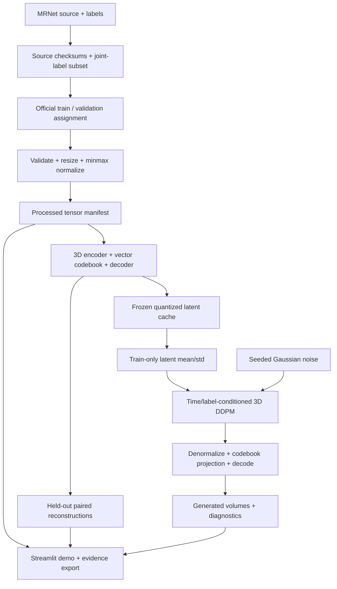

# M2 — Planning and Justification

**Assessment window:** September 21–25, 2026 · **Weight:** 9 marks

**Document prepared:** October 21, 2026

## 1. Review of existing systems — criterion 1

| Approach / reference | Main idea and strengths | Limitation relevant to this project | Design consequence |
|---|---|---|---|
| GANs, Goodfellow et al. [1] | Adversarial training learns a data distribution and supports fast sampling | Training instability and restricted diversity are concerns; a 2D generator alone does not model full 3D context | Use optional patch-adversarial reconstruction training, with a VQ-VAE-only baseline available |
| VQ-VAE, van den Oord et al. [2] | Encoder, learned discrete codebook, and decoder provide trainable compressed representations | Reconstruction is bounded by bottleneck capacity; codebook under-use must be monitored | Record quantization loss and codebook perplexity, then evaluate paired reconstructions |
| VQGAN / Taming Transformers, Esser et al. [3] | Combines vector quantization and adversarial/perceptual compression with a learned prior | Reference system targets natural images and includes components absent from this compact medical baseline | Adapt 3D convolutions and optional patch discriminator; explicitly declare the absence of pretrained perceptual loss |
| DDPM, Ho et al. [4] | Learns iterative Gaussian denoising with a noise-prediction objective | Voxel-space 3D training and many reverse steps are expensive | Train denoising over lower-resolution latent tensors |
| Latent Diffusion, Rombach et al. [5] | Separates compression from diffusion, reducing spatial computation | Natural-image results do not establish medical anatomical fidelity | Train the encoder on actual knee MRI and evaluate its information loss separately |
| Medical Diffusion, Khader et al. [6] | Demonstrates two-stage generation of volumetric medical images and expert evaluation | Paper-scale training/resources and expert assessments exceed a small laptop baseline | Reuse the staged methodology, measure local feasibility, and separate software execution from anatomical validation |
| MRNet, Stanford [7] | Provides real knee exams, labels, and official patient-disjoint splits | Hidden test set, exam-level rather than segmentation labels, no reliable affine in released NumPy arrays | Preserve train/valid assignment; downstream work uses classification; avoid invented geometry |

The comparison is qualitative and literature-based. It is not a head-to-head
benchmark run by this project. Published results in different modalities or
protocols cannot be treated as this project's achieved scores.

## 2. Project feasibility — criterion 1

### Technical feasibility

The project already contains a tested NIfTI/MRNet data layer, a channel-first
PyTorch dataset, a 3D vector-quantized encoder/decoder, an optional discriminator,
a conditioned U-Net/DDPM, evaluation utilities, and a Streamlit interface.
The local machine has an NVIDIA RTX 5070 Ti Laptop GPU with about 12 GiB VRAM.
CUDA-enabled PyTorch 2.11.0+cu128 was installed and a 3D convolution's forward and
backward passes were verified on October 21, 2026.

The M4 configuration uses a reduced, recorded MRNet cohort and 128×128×32 inputs.
The encoder reduces each spatial axis by four, yielding 32×32×8 latent grids.
With eight latent channels, there are eight times fewer floating-point elements
than in the one-channel input; spatial location count alone is reduced by 64.
Compression factors must include channels when discussing actual tensor size.

Peak memory, duration, optimizer steps, and software versions are recorded by
the experiment runner. Batch sizes and run budgets are engineering settings,
not guarantees of convergence or anatomical quality.

### Financial feasibility

| Resource | Budget basis |
|---|---|
| Laptop/GPU | Existing hardware; no new purchase assumed |
| Python, PyTorch, scientific libraries, Streamlit | No paid software subscription required for this implementation |
| Local storage/network | Existing capacity; subset download has an explicit byte budget |
| Dataset | Public Kaggle mirror endpoint; source/unknown mirror-license metadata recorded, with no assertion of a new license |
| Cloud GPU | Not required by the local workflow; no paid cloud job has been commissioned |
| Electricity | Variable; calculate measured average kW × training hours × local price/kWh |

An exact financial total cannot be established without actual electricity and
network tariffs. No grant, payment, purchase, or provider credit is assumed.

### Time feasibility and review schedule

The original assessment windows are recorded in the submission index. Work
prepared now is dated October 21 rather than backdated to those windows.

| Period | Work package | Exit evidence |
|---|---|---|
| Oct 21–22 | Cohort, CUDA setup, preprocessing, baseline training | Source manifest, split counts, checkpoints, measured runtime |
| Oct 22–25 | Reconstruction evaluation, latent diffusion, demo integration | Validation metrics, generated arrays, curves, functioning dashboard |
| Oct 26–30, M4 review | Freeze selected experiment and rehearse demonstration | Verified evidence pack, repeatable commands, limitations slide |
| Before Nov 16–20, M5 | Expand analysis and apply college report format | Formal report/presentation and genuine team contribution records |

This is a work plan; actual timestamps and completed stages come from saved run
evidence. If quality is inadequate, report the baseline limitation and continue
training rather than changing historical results.

## 3. Risks and practical responses — criterion 1

| Risk | Response |
|---|---|
| Data access or mirror changes | Version the source selection and hashes; provide an explicit downloader; retain original source attribution |
| GPU memory pressure | Configurable batch size and spatial shape; log measured memory; do not silently resize a frozen experiment |
| Codebook collapse / oversmoothing | Initialize from training encoder features, monitor perplexity and held-out error, compare slices |
| Diffusion training loss improves but images remain poor | Inspect generated volumes and diversity/continuity diagnostics; avoid interpreting loss alone as quality |
| Split leakage | Trust official MRNet assignment and reject overlapping IDs/lineage; do not randomly split slices |
| Small cohort and limited class coverage | Record selected IDs/seed, class counts, and reduced-cohort scope |
| Re-running changes an artifact | New output directories, source/tensor/checkpoint hashes, explicit resume |

## 4. Objectives — criterion 2

1. Acquire and validate a manageable real knee-MRI cohort with recorded provenance.
2. Produce deterministic, consistently shaped tensors without mixing official splits.
3. Train a 3D VQ representation and measure held-out reconstruction quality.
4. Train a latent-space denoiser with optional genuine exam-label conditioning.
5. Decode seeded random-noise samples into synthetic 3D tensors.
6. Provide traceable evaluation and an interactive trained-model demonstration.
7. Clearly distinguish reduced-cohort baseline results from generalization,
   anatomical fidelity, and downstream benefit.

## 5. System design — criterion 2

## 6. Step-by-step methodology — criterion 2

1. Download a seeded, proportional joint-label subset separately within official
   train and validation assignments; record source files and selected exams.
2. Validate scalar finite 3D arrays. Keep the three acquired planes separate;
   choose sagittal for the training experiment.
3. Transpose `[slice,row,column]` to `[row,column,slice]`, resize with trilinear
   interpolation, and normalize to [-1,1]. Record shape and checksums. This
   retains the field of view but changes resolution; there is no physical affine.
4. Train the VQ encoder/codebook/decoder on training tensors only. Evaluate
   validation reconstruction without gradient updates; select a checkpoint using
   validation reconstruction error, retaining the last checkpoint for resume.
5. Freeze the selected VQ model, encode each split, and fit scalar latent
   normalization on training latents only.
6. Train the U-Net to predict Gaussian noise at randomly sampled timesteps,
   conditioning on genuine exam-label vectors when enabled. Use fixed validation
   noise to make epoch comparisons interpretable.
7. Starting from independent seeded noise, run reverse diffusion, denormalize,
   project to the learned codebook, and decode. Predicted clean latents are
   bounded per channel using the trained codebook's normalized extrema before
   computing the DDPM posterior mean. This prevents near-zero-SNR denoiser
   errors from growing into extreme latents; it does not establish anatomical
   quality. Initial sampling ablations are retained in the run folder.
8. Evaluate held-out VQ reconstruction using MSE, MAE, PSNR, and SSIM. Compare
   with the explicitly defined half-resolution interpolation baseline.
9. Evaluate generated outputs using adaptive 3D pairwise MS-SSIM, intensity
   ranges, adjacent-slice differences, and nearest-training MSE. These are
   diagnostics, not anatomical-validity scores.
10. Export measured results, plots, hashes, configuration, and demo instructions.
    Use the trained model interactively on a validation input and seeded noise.

## 7. Relevance of algorithms and techniques — criterion 3

| Technique | Why it fits the problem | Trade-off / how it is assessed |
|---|---|---|
| 3D convolutions and residual blocks | Learn local features across neighboring slices | Higher memory than 2D; use reduced spatial grids and measure memory |
| VQ codebook + straight-through estimator | Discrete trainable representation with encoder gradients | Monitor codebook loss/perplexity and held-out detail preservation |
| L1 reconstruction + optional patch-adversarial loss | L1 supplies stable paired supervision; adversarial loss can encourage sharper local structure | GAN mode can be unstable and is not enabled merely to claim fidelity |
| 3D U-Net skip connections | Combine local detail and lower-resolution context during denoising | Compact depth is a compute-driven baseline choice |
| Bottleneck spatial/depth self-attention | Models interactions between separated latent locations and slices | Optional, bounded to the lower-resolution bottleneck |
| Sinusoidal timestep embedding and feature modulation | Tell the denoiser how noisy a latent is | Tested with forward noise and deterministic sampling |
| Exam-label conditioning | Tests controllable generation using available MRNet labels | Requested conditions do not verify generated pathology |
| DDPM and cosine noise schedule | Well-defined forward noising and learned reverse denoising [4,8] | Sequential sampling is slower than one-shot generation |
| PSNR/SSIM/MSE/MAE | Compare reconstructed and reference intensities on the same grid | Do not apply them to unrelated real/generated pairs |
| Adaptive 3D MS-SSIM | Describes pairwise similarity/diversity in thin volumes | Record window and scales; values are protocol-specific |
| Content hashes and deterministic seeds | Make results attributable and repeatable | Integrity is distinct from scientific model quality |

### Core algorithm definitions

For encoder output `z = E(x)` and codebook vectors `e_k`, the selected code is
`k* = argmin_k ||z - e_k||²`. The VQ objective combines reconstruction L1 with
`||stop_gradient(z) - e_k*||² + beta ||z - stop_gradient(e_k*)||²`.
The straight-through estimator passes reconstruction gradients to the encoder.

For normalized clean latent `z0`, the forward process is
`z_t = sqrt(alpha_bar_t) z0 + sqrt(1-alpha_bar_t) epsilon`, with
`epsilon ~ N(0,I)`. The denoiser minimizes
`E[||epsilon - epsilon_theta(z_t,t,y)||²]`, where `y` is the genuine exam-label
vector. At inference, the predicted clean latent is computed from that noise
prediction, bounded to the learned codebook channel envelope, and used in the
DDPM posterior mean/variance update. The final latent is projected to codebook
entries and decoded.

### Declared differences from paper-scale systems

The reduced cohort, resized 128×128×32 input, compact networks, training budgets,
and adaptive MS-SSIM protocol are explicit baseline choices. The implementation
does not claim exact Medical Diffusion reproduction. There is no pretrained
perceptual network, classifier-free guidance, or fast DDIM sampler in this run.
Clinical/anatomical review and an independent test-set study remain future work.

## References

1. Goodfellow I. et al. *Generative Adversarial Networks* (2014).
   https://arxiv.org/abs/1406.2661
2. van den Oord A., Vinyals O., Kavukcuoglu K. *Neural Discrete Representation
   Learning* (2017). https://arxiv.org/abs/1711.00937
3. Esser P., Rombach R., Ommer B. *Taming Transformers for High-Resolution Image
   Synthesis* (CVPR 2021). https://arxiv.org/abs/2012.09841
4. Ho J., Jain A., Abbeel P. *Denoising Diffusion Probabilistic Models* (2020).
   https://arxiv.org/abs/2006.11239
5. Rombach R. et al. *High-Resolution Image Synthesis with Latent Diffusion Models*
   (CVPR 2022). https://arxiv.org/abs/2112.10752
6. Khader F. et al. *Medical Diffusion: Denoising Diffusion Probabilistic Models
   for 3D Medical Image Generation*. https://arxiv.org/abs/2211.03364
7. Stanford ML Group. *MRNet dataset and official split policy.*
   https://stanfordmlgroup.github.io/competitions/mrnet/
8. Nichol A., Dhariwal P. *Improved Denoising Diffusion Probabilistic Models*
   (2021). https://arxiv.org/abs/2102.09672
